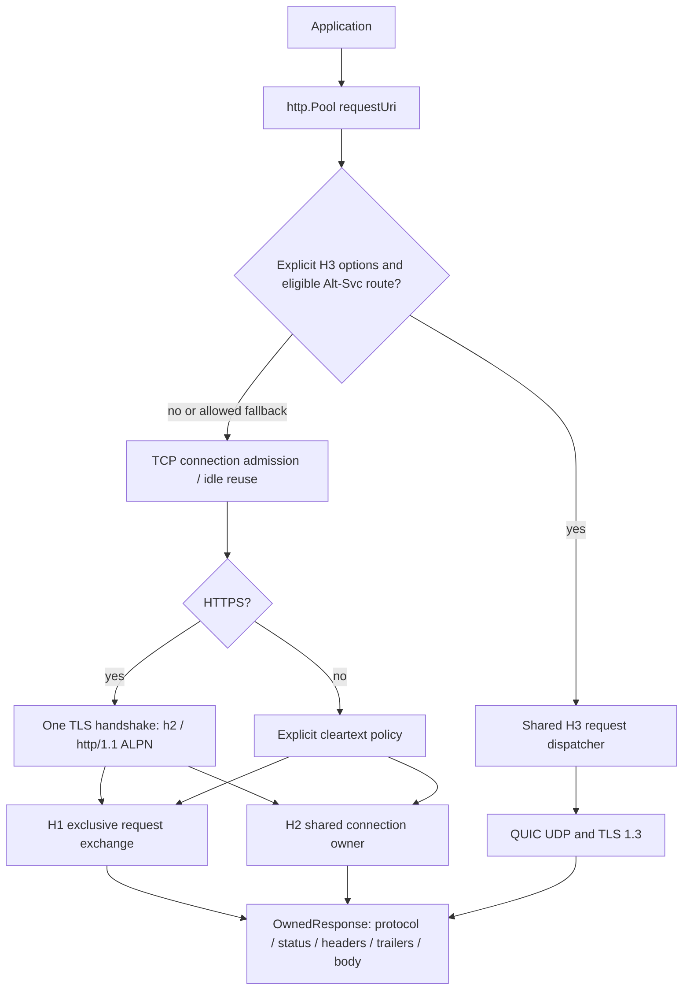

# HTTP functionality review

Reviewed on 2026-11-20 against
`a8015e85e6c0bbd1a33e3719219e50229ac9c00c`, Zig 0.16.0, macOS aarch64.
This is a public-surface, ownership and integration review with selected
loopback checks. Historical peer and performance evidence is identified
separately; this review does not certify every protocol path or rerun benchmarks.

The HTTP implementation covers codecs, live clients and servers, pooling,
streaming, shared request ownership, and application content helpers. The main
integration defect found here is that ordinary pooled H2 requests ignore
`RequestOptions.body_source`, although standalone and duplex APIs support it.
See [findings](#findings-and-next-work) before choosing an upload API.

## Ownership and module map

| Layer | Public entry | Responsibility / owning sources |
| --- | --- | --- |
| Shared HTTP semantics | `netz.http` | Unified client/pool, URI policies, headers, cookies, forms, content decoding and digests; [exports](../src/http/mod.zig), [request/response types](../src/http/client/types.zig). |
| HTTP/1.1 codecs | `netz.http1` | Request/response heads, methods, Host/target checks, framing, chunked bodies and trailers; [module](../src/http1/mod.zig), `head/`, `response_framing.zig`, `chunk_size.zig`, `transfer_encoding.zig`. |
| HTTP/1.1 runtime | `netz.http1.runtime` | TCP/Unix/TLS transports, persistent clients/servers, pull/push bodies, request writers and tunnel handoff; [connection](../src/http1/runtime/connection.zig), [client](../src/http1/runtime/client.zig), `runtime/message/`, `runtime/body_writer.zig`. |
| HTTP/2 codecs | `netz.http2` | Frames, SETTINGS, HPACK/Huffman, priority and peer metadata; [module](../src/http2/mod.zig), `hpack/`. |
| HTTP/2 runtime | `netz.http2.runtime` | Stream state, connection/stream flow control, one frame reader, concurrent serving, shared requests, push and CONNECT; [connection](../src/http2/runtime/connection.zig), `runtime/frame/`, `runtime/headers/`, `runtime/flow/`, `runtime/duplex/`, `runtime/concurrent.zig`. |
| HTTP/3 codecs | `netz.http3` | HTTP/3 messages/control streams, SETTINGS, QPACK, ORIGIN, priority, capsules and CONNECT datagrams; [module](../src/http3/mod.zig), `codec/`, `qpack/`, `settings.zig`, `control.zig`. |
| HTTP/3 runtime | `netz.http3.runtime` | Handshake-backed QUIC sessions, stream routing, paced output, concurrent serving, shared endpoints and pools; [client](../src/http3/runtime/handshake_client.zig), [server session](../src/http3/runtime/handshake_server_session.zig), `runtime/send/`, `runtime/receive/`, `runtime/qpack/`. |
| Stable server streaming aliases | `netz.streaming.http1/http2/http3` | Public aliases to the existing runtime owners, rather than another reader or transport implementation; [aliases](../src/http/streaming.zig). |
| Execution and TLS | `netz.runtime`, `netz.tls` | Protocols consume `std.Io`; the default execution backend is zio. Unified TCP TLS and native handshake-backed H3 use Vail. Direct H1 also retains its standard-library TLS path. |

The application layer in sibling `weft` owns routing, middleware and route
behavior. `netz.http` exports a unified client; server integration uses the
version-specific listeners/connections and stable streaming aliases.
WebSocket, WebTransport and gRPC reuse HTTP transport boundaries but own their
application protocols in their separate modules.

## Unified client and request path

`http.Client` opens H1/H2 connections and implements one-shot URI requests;
`http.Connection` keeps the negotiated H1/H2 transport for explicit reuse.
`http.Pool` adds authority-keyed reuse, shared ordinary H2 requests and the
optional H3 route. Standalone `Client`/`Connection` does not select H3.

| Capability | Behavior and boundary |
| --- | --- |
| Protocol selection | HTTPS defaults to preferring H2, offering H2/H1 in one authenticated handshake; cleartext defaults to H1 and needs explicit H2 prior knowledge. The low-level H2 runtime also supports h2c Upgrade. |
| Endpoint resolution | Hostnames, IPv4 and bracketed IPv6; configurable resolver, sequential address fallback or bounded Happy Eyeballs. TCP identity remains bound to the origin URI rather than the chosen socket address. |
| Complete requests | Common method/header/body/trailer options and owned responses. Repeated headers and trailers remain individually accessible through iterators, including separate Set-Cookie fields. |
| Request body sources | `body_source.slice` or `body_source.reader` is documented to override `body`. Standalone H1/H2 and H3 pool uploads have implementations; ordinary shared H2 Pool calls currently violate that precedence. |
| Duplex requests | `Connection.startRequest`, `Pool.startRequest`, `http.startHttp3Request`; incremental body writes, trailers, final response callbacks and optional informational callbacks. The connection/pool must outlive its handle. |
| Ordinary H2 concurrency | One owner per active origin drives HPACK, frames, uploads and independent stream deadlines. Later requests can join while earlier responses wait. Queue and stream admission are bounded. |
| Manual leases | `Pool.acquireUri` returns an exclusive H1/H2 lease. It does not expose an H3 lease or share its frame reader with ordinary Pool requests. |
| Pool lifecycle | Idle/leased/connecting accounting, per-origin/global idle caps, monotonic expiry, global LRU, FIFO capacity admission, close wakeups and lifecycle counters. An optional total budget spans TCP and H3. |
| Redirects | Explicit `requestUriFollowingRedirects*` calls, relative Location resolution, loop/count bounds, final URI metadata, method/body rewrite policy and one chain deadline. Reader-backed bodies are rejected because they cannot be replayed automatically. |
| Credential policy | Cross-origin credentials and client identities are restricted by default; HTTPS downgrade requires opt-in. Origin/ALPN-scoped ticket caches support resumed TCP and QUIC connections. |
| Stale retry / H3 fallback | One stale reused TCP retry for classified idempotent methods. H3 can back off failed alternatives and fall back under its configured method policy. Consumed Reader replay needs additional guards; see findings. |
| HTTP proxy | Fixed cleartext HTTP/1.1 proxy: absolute-form HTTP; HTTPS CONNECT followed by origin TLS/ALPN. Proxy headers stay proxy-only. H3 is rejected while this proxy is configured. |
| SOCKS5 | TCP CONNECT for H1/H2 and UDP ASSOCIATE for H3, including shared H3 endpoint routing and proxy-side destination DNS. Mutually exclusive with the HTTP proxy option. |

The H3 route is opt-in and learns eligible alternatives from authenticated
Alt-Svc advertisements. ORIGIN-based idle coalescing also requires retained
certificate authority for the additional hostname/IP; a public-key pin alone
does not authorize another origin. A 421 response excludes the request origin.
Optional 0-RTT uses a new connection, remembered origin-scoped H3 SETTINGS and
an origin/ALPN ticket; ordinary idle reuse stays 1-RTT. TLS rejection and a
first 425 can trigger the supported one-time 1-RTT replay.

## Wire-version feature map

| Area | HTTP/1.1 | HTTP/2 | HTTP/3 |
| --- | --- | --- | --- |
| Live transport | TCP/Unix, HTTPS | TCP/Unix prior knowledge, h2c Upgrade, TLS with h2 ALPN | QUIC v1/v2, TLS 1.3 handshake-backed sessions |
| Message framing | Content-Length, chunked and EOF-delimited responses | HEADERS/CONTINUATION, DATA and END_STREAM | HEADERS/DATA/trailing HEADERS, QUIC stream FIN/reset |
| Field compression | Plain field lines | Static/dynamic HPACK and RFC Huffman | Static/dynamic QPACK, persistent encoder/decoder streams and acknowledgments |
| Concurrency | Persistent/pipelined exchange; bounded concurrent connections | Multiplexed streams, shared clients and continuous concurrent handlers | Multiplexed streams, shared UDP endpoint/dispatchers and continuous concurrent handlers |
| Request/response streaming | Pull BodyReader and callback consumers; incremental writers | Step-driven duplex streams and per-handler pull bodies | Request/response events, incremental message readers, paced senders and per-handler pull bodies |
| Informational responses | Bounded ordered 1xx, Expect/100-continue | Bounded ordered 1xx, Expect/100-continue | Bounded ordered 1xx, Expect/100-continue; concurrent informational-plus-body helper has a restriction below |
| Flow and scheduling | Socket backpressure; checked write progress | Stream/connection windows, WINDOW_UPDATE, optional BDP adaptation, legacy and RFC 9218 priorities | QUIC stream/connection windows, recovery/congestion/pacing feedback and RFC 9218 priorities |
| Shutdown / cancellation | Persistence policy, half-close/drain, failed-read respondAndClose, tunnel/Upgrade handoff | Stream resets, sibling isolation, bounded terminal cleanup, GOAWAY and retry classification | Stream cancellation/reset, critical stream errors, GOAWAY and request retry classification |
| Advanced extensions | CONNECT/generic Upgrade and Capsule-based CONNECT-UDP/IP adapters | Push, traditional/extended CONNECT, RFC 8441 WebSocket, ORIGIN/ALTSVC, Capsule adapters | Push, RFC 9220 WebSocket, ORIGIN, HTTP Datagram/Capsule, CONNECT-UDP/IP and WebTransport adapters |

HTTP/1 method handling accepts case-sensitive RFC token extension methods;
registered methods retain their fast paths. QUERY is classified safe and
idempotent, while unknown extension methods are conservative. HEAD, CONNECT,
1xx, 204 and 304 have method/status-specific body and persistence rules.
Strict HTTP/1 Host/authority and TE/CL checks protect message boundaries;
compatibility parsing switches are explicit. HTTP/1.0 and HTTP/0.9 are outside
the supported version surface.

H2 server owners serialize frame reads, HPACK and writes. H3 owners serialize
QUIC receive, QPACK, stream events and output. Concurrent handlers exchange
commands and pull bounded body buffers rather than reading the shared socket.
The server loop accepts streams continuously, limits active handlers and
supports shutdown and optional worker-thread caps.

For H3, `runtime.Server`/`Client` are development transports, and the lightweight
`ProtectedServer`/`ProtectedClient` use preconfigured keys without the complete
handshake/recovery owner. Choose `HandshakeClient`, `HandshakeServer` and
`HandshakeServerSession` for the full QUIC transport path. Errors named
`HpackDynamicTableUnsupported`/`QpackDynamicTableUnsupported` in stateless
convenience decoders do not mean the connection runtimes lack dynamic tables.

## Content helpers and defaults

| Helper | Functionality and integration |
| --- | --- |
| Content-Encoding | identity/gzip/deflate/br/zstd; stacked reverse-order decoding, allocating/caller-buffer APIs and bounded incremental decoders. `OwnedResponse.body()` retains encoded content; call `decodeContentAlloc`/`decodeContentInto` or compose a streaming decoder explicitly. |
| Content digests | RFC 9530 Content-Digest/Repr-Digest and Want-* preferences, SHA-256/SHA-512, generation, header/trailer parsing and streaming hashing. Content hashing retains Content-Encoding after removing transfer framing. This module implements content integrity fields, not RFC 7616 Digest authentication. |
| URL-encoded forms | Writer/parser, percent escaping, plus/space conversion and malformed-escape rejection. |
| Multipart | Slice/Reader writers, exact length when available, pull encoding, filename*, allocating and streaming parsers, limits on parts/headers/metadata/body bytes. Nested multipart is rejected; uploaded filename filesystem policy belongs to the application. |
| CookieJar | Domain/path/expiry, Secure/HttpOnly/SameSite, cookie prefixes, partition keys, bounded retention, snapshots and Netscape import/export. The jar is explicit and single-owner; callers serialize shared access. |
| CookieSession | Composes Pool + Jar, generates Cookie per URI and stores every Set-Cookie before following a redirect. Bare Client/Pool does not automatically maintain a jar. |
| Authority / early data / Alt-Svc | Shared normalized origin and authority rules; explicit RFC 8470 forwarding/safety helpers; bounded alternative retention, expiry and failure backoff. |

| Default | Value / implication |
| --- | --- |
| Unified selection | `prefer_http2`, cleartext H1, allowed authenticated no-ALPN H1 fallback; H3 options are null. |
| Unified TCP pool | 64 total TCP connections, 32 idle globally, 8 idle per origin, 90-second idle expiry. |
| Combined TCP/H3 cap | `max_total_connections = 0`: backend caps are independent until an explicit combined cap is configured. Optional H3 backend defaults to 32 connections. |
| Ordinary shared H2 requests | 256 retained requests, 64 local streams per connection, 16-KiB upload quantum; peer SETTINGS can impose a lower stream limit. |
| H1 runtime | 64-KiB head, 100 request headers in serve helpers, 65,534-byte request target and 16-MiB body cap. |
| H2 runtime | 16-MiB body cap, 256 decoded header fields, fixed receive windows by default; adaptive BDP windows are opt-in. Terminal transport cleanup defaults to a separate 10-ms budget. |
| H3 runtime | 16-MiB body cap, 128 concurrent retained request streams. Development stream buffering and lightweight Protected buffering default to 64 KiB; handshake session limits are configured separately. Local QPACK blocked-stream support is capped at 128 and SETTINGS must enable dynamic capacity explicitly. |
| Timeouts | Many connection/head/idle deadlines are optional. `WithTimeout`/`WithDeadline` operations preserve one absolute operation deadline rather than renewing it on partial progress; configured phase budgets may be stricter. H2 terminal cleanup can add its documented finite cleanup budget. |
| Redirects | 10 hops, no insecure downgrade or cross-origin credential/client-identity forwarding by default; POST 301/302 rewrite-to-GET is enabled. |
| Cookie domain policy | Host-only by default: Set-Cookie with Domain is rejected unless a different policy is explicitly chosen. A current PSL checker and IDNA A-label conversion are application inputs. |

## Findings and next work

| ID | Priority | Finding | Evidence / next action |
| --- | --- | --- | --- |
| F1 | P1 correctness | Ordinary shared H2 Pool requests ignore `body_source`, using `body` for Content-Length and DATA. Reader/slice precedence differs from the standalone client and H1/H3 paths. | **Reproduced** on a real h2c connection: both sources delivered `fallback`. [Exchange.init/write](../src/http/client_pool/shared_tcp/exchange.zig), [probe evidence](evidence/http_functional_review/2026-11-20/README.md). Add both source variants to pooled tests and implement source-aware bounded ownership or a validated fallback. Until then use standalone Connection or `Pool.startRequest` for these H2 uploads. |
| F2 | Resolved | H1 streaming trailer names now use stack storage through 16 fields and exact overflow allocation above that capacity. | Reader-backed and duplex uploads exercise 16/17/40 trailers over one persistent H1 connection. `DuplexHeader` now aliases the common `http.Header`, including H2/H3 never-indexed metadata. The original static finding was at the audit baseline. The focused trailer/duplex bundle passed 93/93 tests on 2026-11-20, including support tests. |
| F3 | P1 replay | Stale TCP retry and H3 fallback check method/error policy without tracking whether a Reader has already been consumed or can restart. | **Static inspection**, no fault-injected replay result: [retry/fallback](../src/http/client_pool/requests.zig), [Reader type](../src/http/client/types.zig). Idempotency does not reconstruct an exhausted body. Add consumed-prefix/disconnect tests, and suppress automatic replay or require a restartable source. |
| F4 | P2 facade coverage | H3 concurrent `startResponseWithBodyAndInformational` rejects non-final initial body contributions or response trailers when informational heads are supplied. | Explicit `InformationalStreamingUnsupported` branch in [concurrent.zig](../src/http3/runtime/concurrent.zig). Lower-level H3 1xx support is broader. Decide whether the facade needs independent informational writes, then test 103 + several DATA chunks + trailers. |
| F5 | P2 documentation | weft integration request 8 remained open after empty H2 body completion and `bodyFinished()` were delivered; the docs index described content digests as authentication. | EOF regression passed in this review; current [createSlot](../src/http2/runtime/concurrent.zig) seeds completed state. Integration status and index wording corrected with this review. Historical evidence READMEs retain their original scope. |
| F6 | P2 structure/evidence | Several runtime/owner files remain large, and feature descriptions are spread through a 4,000+ line parity log. | Keep this overview as an entry point; extract cohesive owner responsibilities without changing single-reader ownership. Add a current feature/evidence index rather than interpreting old counts as current certification. |

The fixed HTTP proxy has explicit product limits: no TLS connection to the
proxy itself, authentication challenge exchange, PAC or automatic proxy
selection. Its forward-H1 path rejects Reader and duplex body streaming. H3
through an HTTP proxy is rejected rather than bypassing that route. Streaming
multipart parsing exists, but nested multipart is not supported. These are
supported-scope boundaries rather than the reproduced H2 precedence defect.

## Verification and further reading

The selected duplex/negotiation/Alt-Svc/global-budget bundle passed **99/99**
tests, including imported support tests. The pooled H2 body-source probe failed
its public-precedence assertion after observing both source variants; its
combined H2 EOF run passed **127/128** overall with that one expected finding.
The H2 EOF target itself passed **33/33**. The temporary probe import was
removed; source hashes, patch and exact failing log are archived in
[the review evidence](evidence/http_functional_review/2026-11-20/README.md).

Scoped public entry points are `test-http`, `test-http1`, `test-http2` and
`test-http3`, each accepting `-Dtest-filter`. Their matching-test guard prevents
dependency-only passes from satisfying an empty selected protocol suite.
The complete `zig build test` also runs other protocol families and fixture
checkers, so it is not the default gate for a narrow HTTP review.

Historical independent evidence includes strict h2spec **147/147** separately
over h2c, TLS 1.3 and TLS 1.2 (2026-11-07), Hyper/rustls ordinary/shared H2
ownership gates, curl/nghttp2 peers, quic-go/tquic H3 gates and live connection
fuzz targets. Those runs support their captured owning revisions and workload
shapes; they are not fresh full-suite or benchmark results from this review.

Start with [pool ownership](http_client_pool.md) and
[streaming contracts](http_streaming.md). Detailed protocol history is in
[Hyper/HTTP parity](hyper_parity.md) and [coverage](coverage.md).
Content helpers are described in [forms](http_forms.md) and
[content digests](http_digest.md); proxy and trust policy are in
[HTTP proxy](http_proxy.md) and [trust roots](trust_roots.md).
