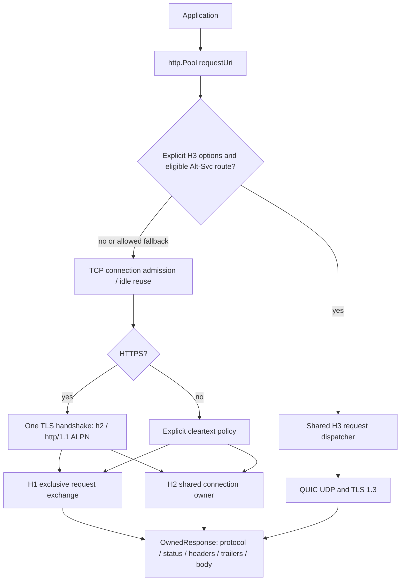

# HTTP functionality review

Reviewed on 2026-11-20 against
`a8015e85e6c0bbd1a33e3719219e50229ac9c00c`, Zig 0.16.0, macOS aarch64.
This is a public-surface, ownership and integration review with selected
loopback checks. Historical peer and performance evidence is identified
separately; this review does not certify every protocol path or rerun benchmarks.

The HTTP implementation covers codecs, live clients and servers, pooling,
streaming, shared request ownership, and application content helpers. The original main
integration defect was that ordinary pooled H2 requests ignored
`RequestOptions.body_source`; that behavior and consumed-body replay are now
repaired. The finding table records current delivery status.
See [findings](#findings-and-next-work) before choosing an upload API.

## Ownership and module map

| Layer | Public entry | Responsibility / owning sources |
| --- | --- | --- |
| Shared HTTP semantics | `netz.http` | Unified client/pool, URI policies, headers, cookies, forms, content decoding and digests; [exports](../src/http/mod.zig), [request/response types](../src/http/client/types.zig). |
| HTTP/1.1 codecs | `netz.http1` | Request/response heads, methods, Host/target checks, framing, chunked bodies and trailers; [module](../src/http1/mod.zig), `head/`, `response_framing.zig`, `chunk_size.zig`, `transfer_encoding.zig`. |
| HTTP/1.1 runtime | `netz.http1.runtime` | TCP/Unix/TLS transports, persistent clients/servers, pull/push bodies, request writers and tunnel handoff; [connection](../src/http1/runtime/connection.zig), [client](../src/http1/runtime/client.zig), [request writer](../src/http1/runtime/request_writer.zig), [response writer](../src/http1/runtime/response_writer.zig), `runtime/message/`, `runtime/body_writer.zig`. |
| HTTP/2 codecs | `netz.http2` | Frames, SETTINGS, HPACK/Huffman, priority and peer metadata; [module](../src/http2/mod.zig), `hpack/`. |
| HTTP/2 runtime | `netz.http2.runtime` | Stream state, connection/stream flow control, one frame reader, concurrent serving, shared requests, push and CONNECT; [connection](../src/http2/runtime/connection.zig), `runtime/frame/`, `runtime/headers/`, `runtime/flow/`, `runtime/duplex/`, `runtime/concurrent.zig`. |
| HTTP/3 codecs | `netz.http3` | HTTP/3 messages/control streams, SETTINGS, QPACK, ORIGIN, priority, capsules and CONNECT datagrams; [module](../src/http3/mod.zig), `codec/`, `qpack/`, `settings.zig`, `control.zig`. |
| HTTP/3 runtime | `netz.http3.runtime` | Handshake-backed QUIC sessions, stream routing, paced output, concurrent serving, shared endpoints and pools; [client](../src/http3/runtime/handshake_client.zig), [server session](../src/http3/runtime/handshake_server_session.zig), `runtime/send/`, `runtime/receive/`, `runtime/qpack/`. |
| Stable server streaming aliases | `netz.streaming.http1/http2/http3` | Public aliases to the existing runtime owners, rather than another reader or transport implementation; [aliases](../src/http/streaming.zig). |
| Execution and TLS | `netz.runtime`, `netz.tls` | Protocols consume `std.Io`; the default execution backend is zio. Unified TCP TLS and native handshake-backed H3 use Vail. Direct H1 also retains its standard-library TLS path. |
| One-port ALPN dispatch | `netz.tls.alpn_server` | Completes the TLS handshake and reports the selected protocol; transfer the accepted connection to `http1.runtime.adoptNegotiatedTlsServer` or `http2.runtime.adoptNegotiatedTlsServer`. [listener](../src/tls/alpn_server.zig), [example](../examples/http/alpn_server.zig). |

The application layer in sibling `weft` owns routing, middleware and route
behavior. `netz.http` exports a unified client; server integration uses the
version-specific listeners/connections and stable streaming aliases.
WebSocket, WebTransport and gRPC reuse HTTP transport boundaries but own their
application protocols in their separate modules.

TLS connection setup retains ownership of the connected TCP stream while it
rechecks the caller's deadline. An expiry between TCP completion and TLS
initialization returns `Timeout` and closes that stream once; a successful TLS
initialization transfers cleanup responsibility to the TLS connection. H1
standard/vail, H2 and WSS use this ordering. The
[transition regressions](evidence/tls_transition_ownership/2026-11-24/README.md)
observe real socket closes and peer EOF through the public named/address APIs.

H2c `Client.connectStreamUpgrade*` also consumes the supplied stream at entry,
including expired/foreign-clock deadlines and non-positive timeouts. Failed
admission closes it before sending the HTTP/1 Upgrade request. The TCP-opening
Upgrade constructors retain the same cleanup responsibility when the budget
expires after connect. Successful `H2cUpgradeResult` values own both the H2
connection and consumed 101 metadata. The [h2c ownership regressions](evidence/h2c_upgrade_ownership/2026-11-24/README.md)
cover both budget forms and observe one close and peer EOF.

## Unified client and request path

`http.Client` opens H1/H2 connections, or H3 with `prefer_http3`/`http3_only`, and
implements one-shot URI requests; `http.Connection` retains the transport for reuse.
`http.Pool` adds authority-keyed reuse, shared ordinary H2 requests and the
optional H3 route. Direct H3 uses an exclusive QUIC owner and the same request
and duplex methods; see [direct H3](http_direct_h3.md).

| Capability | Behavior and boundary |
| --- | --- |
| Protocol selection | `prefer_http3` tries H3 then H2/H1 before sending a request; `prefer_http2` offers H2/H1 in one authenticated handshake and remains the default. Cleartext defaults to H1 and needs explicit H2 prior knowledge. See [policy](http_protocol_policy.md). |
| Endpoint resolution | Hostnames, IPv4 and bracketed IPv6; configurable resolver, sequential address fallback or bounded Happy Eyeballs. TCP identity remains bound to the origin URI rather than the chosen socket address. |
| Complete requests | Common method/header/body/trailer options and owned responses. Repeated headers and trailers remain individually accessible through iterators, including separate Set-Cookie fields. Pooled H3 callbacks preserve interim ordering and never-indexed fields without an extra trailer-count ceiling. |
| Request body sources | `body_source.slice` or `body_source.reader` overrides `body` across standalone and pooled H1/H2/H3. Reader production is bounded, and complete-request deadlines include cooperative source reads. |
| Duplex requests | `Connection.startRequest`, `Pool.startRequest`, `http.startHttp3Request`; incremental body writes, trailers, final response callbacks and optional informational callbacks. The connection/pool must outlive its handle. Completed reads return the retained final head without replaying callbacks. |
| Ordinary H2 concurrency | One owner per active origin drives HPACK, frames, uploads and independent stream deadlines. Later requests can join while earlier responses wait. Queue and stream admission are bounded. |
| Manual leases | `Pool.acquireUri` returns an exclusive H1/H2/H3 primary connection lease under the common protocol policy. Optional Alt-Svc H3 dispatcher commands retain their separate ownership. |
| Pool lifecycle | Idle/leased/connecting accounting, per-origin/global idle caps, monotonic expiry, global LRU, FIFO capacity admission, close wakeups and lifecycle counters. An optional total budget spans TCP and H3. |
| Redirects | Explicit `requestUriFollowingRedirects*` calls, relative Location resolution, loop/count bounds, final URI metadata, method/body rewrite policy and one chain deadline. Single-pass Readers are rejected; explicitly replayable Readers reset for preserving hops. |
| Credential policy | Cross-origin credentials and client identities are restricted by default; HTTPS downgrade requires opt-in. Origin/ALPN-scoped ticket caches support resumed TCP and QUIC connections. |
| Stale retry / H3 fallback | One stale reused TCP retry for classified idempotent methods. H3 can back off failed alternatives and fall back under its configured method policy. Reader replay requires an explicit reset callback; single-pass sources preserve their first error. See [body sources](http_bodies.md). |
| HTTP proxy | Fixed cleartext HTTP/1.1 proxy: absolute-form HTTP; HTTPS CONNECT followed by origin TLS/ALPN. Proxy headers stay proxy-only. H3 is rejected while this proxy is configured. |
| SOCKS5 | TCP CONNECT for H1/H2 and UDP ASSOCIATE for H3, including shared H3 endpoint routing and proxy-side destination DNS. Mutually exclusive with the HTTP proxy option. |

The H3 route is opt-in and learns eligible alternatives from authenticated
Alt-Svc advertisements. ORIGIN-based idle coalescing also requires retained
certificate authority for the additional hostname/IP; a public-key pin alone
does not authorize another origin. A 421 response excludes the request origin.
Optional 0-RTT uses a new connection, remembered origin-scoped H3 SETTINGS and
an origin/ALPN ticket; ordinary idle reuse stays 1-RTT. TLS rejection and a
first 425 can trigger the supported one-time 1-RTT replay.

## Authentication and trust

The unified HTTP client, pool and Alt-Svc H3 routes verify the server
certificate by default; an explicit policy replaces the default trust set.
Low-level QUIC/H3 handshake helpers keep the explicit-configuration contract
described in [the protocol API map](protocol_api_map.md).

| Need | Client configuration | Boundary |
| --- | --- | --- |
| Public origins | none | Platform roots. `.tls.root_source = .bundled` selects the compiled-in Mozilla roots in minimal containers. |
| Private CA file (TCP TLS) | `.tls.ca_bundle = .{ .bundle = &bundle, .lock = &lock }` | H1/H2 only; QUIC has no CA-bundle equivalent. |
| Private CA for TCP and H3 | `.tls.system_store = &store` from `netz.tls.trust.SystemStore.initWithPaths` or `initEmpty` + `addCompatibleCertificate` | Inherited by the direct H3 route and the pool's Alt-Svc backend. |
| Pin one key | `.tls.server_verifier = .{ .pinned_ecdsa_p256_public_key = key }` | Replaces the CA path; use it when the peer key is known out of band. |
| Skip hostname match | `.tls.verify_host = false` | TCP TLS only; CA path, validity, EKU and revocation checks still run. H3 routes keep the configured verifier's own hostname policy. Intended for tunnels. |
| Client certificate (mTLS) | `.tls.client_identity = .{ .certificate_chain = ..., .signer = ... }` | H1/H2/H3 and WebTransport share the same shape. |

The direct H3 route and the Alt-Svc pool backend copy `.tls.server_verifier`,
`.tls.system_store`, `.tls.environ`, `.tls.root_source` and `.tls.verify_host`
into the QUIC handshake when no explicit `http3.handshake.handshake` trust is
configured; `server_auth` and `client_identity` there override the inherited
policy. A TCP `ca_bundle` cannot be translated to QUIC, so Alt-Svc H3 fails
`Pool.init` with `error.UnsupportedH3TrustConfiguration` instead of connecting
unverified, while `prefer_http3` keeps that request on TCP.

HTTP-level credentials are ordinary fields. `Authorization`, `Cookie` and
application headers travel in the request head; `http_proxy.headers` are sent
only to the proxy (absolute-form or CONNECT), never to the origin.
`netz.http.CookieSession` persists `Set-Cookie` across pooled requests.
Redirects strip `Authorization`, `Proxy-Authorization`, `Cookie` and `Cookie2`
on cross-origin hops, refuse to offer a TLS client identity unless
`RedirectPolicy.allow_cross_origin_client_identity` is set, and reject
HTTPS-to-HTTP downgrades unless `allow_insecure_downgrade` is set.

ALPN does not authenticate anyone; it selects the wire protocol after
certificate verification. H1 accepts `http/1.1` or a legacy no-ALPN peer, H2
requires `h2`, H3 requires `h3` (or an `h3-NN` draft identifier), WSS requires
`http/1.1`, and MQTT requires `mqtt`. `netz.tls.alpn_server` exposes the
selected protocol so one port can dispatch to the matching runtime
(`zig build run-http-alpn-server`).

Server side, `TlsListenOptions.identity` supplies the certificate and
`identity_provider` rotates it per handshake. `client_auth = .{ .verifier =
... }` requires a client certificate, and handlers read the authenticated
chain from `Connection.peerCertificates()` (`zig build run-http-mutual-tls`).
Client connections expose the remote transport peer through
`http.Connection.peerAddress()`. [Peer address contracts](peer_addresses.md)
cover nullable TCP metadata, Unix streams, proxies and QUIC paths.

Buffered H1/H2 requests and H3 handshake requests expose the accepted peer as
`Request.from`, `OwnedRequest.from` and `OwnedHandshakeRequest.from`; batch,
streaming and pull-body shapes carry the same field.
There is no built-in user/password HTTP authentication: applications validate
`Authorization` themselves.

Examples: `run-http-https-client` (pinned key), `run-http-custom-ca` (private
CA through a system store), `run-http-mutual-tls`, `run-http-client-auth`
(Bearer/Basic and a 401 challenge), `run-http-proxy-client` (proxy
credentials), `run-http-cookie-session`, `run-http-alpn-server`.

## Wire-version feature map

| Area | HTTP/1.1 | HTTP/2 | HTTP/3 |
| --- | --- | --- | --- |
| Live transport | TCP/Unix, HTTPS | TCP/Unix prior knowledge, h2c Upgrade, TLS with h2 ALPN | QUIC v1/v2, TLS 1.3 handshake-backed sessions |
| Message framing | Content-Length, chunked and EOF-delimited responses | HEADERS/CONTINUATION, DATA and END_STREAM | HEADERS/DATA/trailing HEADERS, QUIC stream FIN/reset |
| Field compression | Plain field lines | Static/dynamic HPACK and RFC Huffman | Static/dynamic QPACK, persistent encoder/decoder streams and acknowledgments |
| Concurrency | Persistent/pipelined exchange; bounded concurrent connections | Multiplexed streams, shared clients and continuous concurrent handlers | Multiplexed streams, shared UDP endpoint/dispatchers and continuous concurrent handlers |
| Request/response streaming | Pull BodyReader and callback consumers; incremental writers | Step-driven duplex streams and per-handler pull bodies | Request/response events, incremental message readers, paced senders and per-handler pull bodies |
| Informational responses | Bounded ordered 1xx, Expect/100-continue | Bounded ordered 1xx, Expect/100-continue | Bounded ordered 1xx, Expect/100-continue; concurrent informational writes compose with body contributions and trailers |
| Flow and scheduling | Socket backpressure; checked write progress | Stream/connection windows, WINDOW_UPDATE, optional BDP adaptation, legacy and RFC 9218 priorities | QUIC stream/connection windows, recovery/congestion/pacing feedback and RFC 9218 priorities |
| Shutdown / cancellation | Persistence policy, half-close/drain, failed-read respondAndClose, tunnel/Upgrade handoff | Stream resets, sibling isolation, bounded terminal cleanup, GOAWAY and retry classification | Stream cancellation/reset, critical stream errors, GOAWAY and request retry classification |
| Advanced extensions | CONNECT/generic Upgrade and Capsule-based CONNECT-UDP/IP adapters | Push, traditional/extended CONNECT, RFC 8441 WebSocket, ORIGIN/ALTSVC, Capsule adapters | Push, RFC 9220 WebSocket, ORIGIN, HTTP Datagram/Capsule, CONNECT-UDP/IP and WebTransport adapters |

HTTP/1 method handling accepts case-sensitive RFC token extension methods;
registered methods retain their fast paths. QUERY is classified safe and
idempotent, while unknown extension methods are conservative. HEAD, CONNECT,
1xx, 204 and 304 have method/status-specific body and persistence rules.
Strict HTTP/1 Host/authority and TE/CL checks protect message boundaries;
compatibility parsing switches are explicit. HTTP/1.0 and HTTP/0.9 are outside
the supported version surface.

H2 server owners serialize frame reads, HPACK and writes. H3 owners serialize
QUIC receive, QPACK, stream events and output. Concurrent handlers exchange
commands and pull bounded body buffers rather than reading the shared socket.
The server loop accepts streams continuously, limits active handlers and
supports shutdown and optional worker-thread caps.

For H3, `runtime.Server`/`Client` are development transports, and the lightweight
`ProtectedServer`/`ProtectedClient` use preconfigured keys without the complete
handshake/recovery owner. Choose `HandshakeClient`, `HandshakeServer` and
`HandshakeServerSession` for the full QUIC transport path. Errors named
`HpackDynamicTableUnsupported`/`QpackDynamicTableUnsupported` in stateless
convenience decoders do not mean the connection runtimes lack dynamic tables.

## Content helpers and defaults

| Helper | Functionality and integration |
| --- | --- |
| Content-Encoding | identity/gzip/deflate/br/zstd; stacked reverse-order decoding, allocating/caller-buffer APIs and bounded incremental decoders. `OwnedResponse.body()` retains encoded content; call `decodeContentAlloc`/`decodeContentInto` or compose a streaming decoder explicitly. |
| Content digests | RFC 9530 Content-Digest/Repr-Digest and Want-* preferences, SHA-256/SHA-512, generation, header/trailer parsing and streaming hashing. Content hashing retains Content-Encoding after removing transfer framing. This module implements content integrity fields, not RFC 7616 Digest authentication. |
| URL-encoded forms | Writer/parser, percent escaping, plus/space conversion and malformed-escape rejection. |
| Multipart | Slice/Reader writers, exact length when available, pull encoding, filename*, allocating and streaming parsers, limits on parts/headers/metadata/body bytes. Nested multipart is rejected; uploaded filename filesystem policy belongs to the application. |
| CookieJar | Domain/path/expiry, Secure/HttpOnly/SameSite, cookie prefixes, partition keys, bounded retention, snapshots and Netscape import/export. The jar is explicit and single-owner; callers serialize shared access. |
| CookieSession | Composes Pool + Jar, generates Cookie per URI and stores every Set-Cookie before following a redirect. Bare Client/Pool does not automatically maintain a jar. |
| Authority / early data / Alt-Svc | Shared normalized origin and authority rules; explicit RFC 8470 forwarding/safety helpers; bounded alternative retention, expiry and failure backoff. |

| Default | Value / implication |
| --- | --- |
| Unified selection | `prefer_http2`, cleartext H1, allowed authenticated no-ALPN H1 fallback. `prefer_http3` advances through H3/H2/H1; strict H3 uses `http3_only`. Both apply to Client and primary Pool leases. |
| Unified primary pool | 64 primary H1/H2/H3 connections, 32 idle globally, 8 idle per origin, 90-second idle expiry. |
| Combined TCP/H3 cap | `max_total_connections = 0`: backend caps are independent until an explicit combined cap is configured. Optional H3 backend defaults to 32 connections. |
| Ordinary shared H2 requests | 256 retained requests, 64 local streams per connection, 16-KiB upload quantum; peer SETTINGS can impose a lower stream limit. |
| H1 runtime | 64-KiB head, 100 request headers in serve helpers, 65,534-byte request target and 16-MiB body cap. |
| H2 runtime | 16-MiB body cap, 256 decoded header fields, fixed receive windows by default; adaptive BDP windows are opt-in. Terminal transport cleanup defaults to a separate 10-ms budget. |
| H3 runtime | 16-MiB body cap, 128 concurrent retained request streams. Development stream buffering and lightweight Protected buffering default to 64 KiB; handshake session limits are configured separately. Local QPACK blocked-stream support is capped at 128 and SETTINGS must enable dynamic capacity explicitly. |
| Timeouts | Many connection/head/idle deadlines are optional. `WithTimeout`/`WithDeadline` operations preserve one absolute operation deadline rather than renewing it on partial progress; configured phase budgets may be stricter. H2 terminal cleanup can add its documented finite cleanup budget. |
| Redirects | 10 hops, no insecure downgrade or cross-origin credential/client-identity forwarding by default; POST 301/302 rewrite-to-GET is enabled. |
| Cookie domain policy | Host-only by default: Set-Cookie with Domain is rejected unless a different policy is explicitly chosen. A current PSL checker and IDNA A-label conversion are application inputs. |

## Findings and next work

| ID | Priority | Finding | Evidence / next action |
| --- | --- | --- | --- |
| F1 | Resolved | Ordinary shared H2 Pool requests now resolve `body_source` before Content-Length or DATA and stream Reader bodies through one bounded producer per request. | Real h2c coverage checks 70-KiB slice/known/unknown Reader bodies under a 320-byte stream window, empty Reader trailers, late siblings and zio cancellation with same-connection reuse. [Delivery evidence](evidence/http_body_sources/2026-11-20/README.md). |
| F2 | Resolved | H1 streaming trailer names now use stack storage through 16 fields and exact overflow allocation above that capacity. | Reader-backed and duplex uploads exercise 16/17/40 trailers over one persistent H1 connection. `DuplexHeader` now aliases the common `http.Header`, including H2/H3 never-indexed metadata. The original static finding was at the audit baseline. The focused trailer/duplex bundle passed 93/93 tests on 2026-11-20, including support tests. |
| F3 | Resolved | Stale TCP retry, H3 fallback and body-preserving redirects require a replayable source. Reader rewind is explicit, and source read failures are distinct from transport failure. | Real tests cover consumed single-pass refusal, complete stale replay, failed rewind without redial, source failure without retry, 307 redirects and H3 upload rejection followed by exact TCP replay. [Body API](http_bodies.md). |
| F4 | Resolved | Concurrent H2/H3 streams expose independent informational writes and deadline forms. H3 compound responses support continued DATA, final trailers and empty-content status rules. | Native/development gates cover ordered 100/103, body/trailer composition, HEAD/204/304, whole-list preflight, wide headers, and literal failure/retry offsets. [Delivery evidence](evidence/http_informational_composition/2026-11-20/README.md). |
| F5 | Resolved | weft integration request 8 and the content-digest index wording now match their implemented scope. | EOF regression passed in this review; current [createSlot](../src/http2/runtime/concurrent.zig) seeds completed state. Historical evidence READMEs retain their original scope. |
| F6 | Resolved for this review | Cohesive request/response writers, response sequencing, direct H3 ownership, H3 response collection, Reader pumping and response sinks now have separate owning modules. This overview indexes current contracts and delivery evidence. | The existing single-reader owners remain intact. Native owner size is an ongoing maintenance constraint in [architecture](architecture.md), rather than an uncompleted feature in this review. |
| F7 | Resolved | Timed TCP reads preserve socket registration, cancellation joins and accepted late bytes/EOF. | [Socket ownership evidence](evidence/http_socket_read_ownership/2026-11-20/README.md) covers native zio and wrapped I/O vtables with subsequent same-connection reuse. |
| F8 | Resolved | H1 native and unified/pool upload operations compose setup, body, finish and trailer deadlines, with explicit acceptance progress. Oversized pooled H3 contributions use bounded queues and packet-aware fragments. | [Native H1 evidence](evidence/http1_streaming_deadlines/2026-11-20/README.md), [unified upload evidence](evidence/http_streaming_upload_deadlines/2026-11-20/README.md). |
| F9 | Resolved | `Client`/`Connection` expose explicit H3 with common requests, streaming, negotiation metadata and redirect policy. Reader deadlines include cooperative source waits and retain interrupted upload suffixes. | [Direct H3 and Reader delivery](evidence/http_direct_h3/2026-11-20/README.md); [public H3 guide](http_direct_h3.md). |
| F10 | Resolved | Common response sinks compose with `std.Io.Writer`, support discard and optional callbacks; direct and pool handles offer response timeout forms. Explicit `Pool.StreamHandle.discard()` now closes its TCP lease. | [Streaming contracts](http_streaming.md) cover callback lifetimes, writer flushing, error propagation and release behavior. |
| F11 | Resolved | `prefer_http3` selects H3 then H2/H1 before sending a request, with bounded H3 feasibility and one caller deadline. Client and primary Pool leases share this policy, including strict H3 and manual leases. | [Protocol policy](http_protocol_policy.md), [selection evidence](evidence/http_protocol_policy/2026-11-20/README.md). |
| F12 | Resolved | Native QUIC client/server default CRYPTO limits now admit ordinary full certificate flights and large mTLS chains. The 4-KiB default rejected a real 4109-byte server flight. | [Handshake limit evidence](evidence/quic_handshake_crypto_limits/2026-11-21/README.md); the 256-KiB default remains bounded and explicitly configured smaller limits retain rejection behavior. |
| F13 | Resolved | Handshake-level CRYPTO flights are packetized to the endpoint datagram bound and client flights are reassembled across datagrams. Client flight packet numbers advance past the complete protected range. | 1200-byte endpoints now carry a 16-entry certificate chain with server auth and mTLS on both I/O backends. [Protocol review evidence](evidence/protocol_review/2026-11-21/README.md). |
| F14 | Resolved | H3 stream startup no longer double-frees its stream/handle on timeout, and a failed pending connection now wakes the waiting stream instead of waiting for the outer request deadline. Alt-Svc setup failures fall back without requiring a Reader rewind. | A 150-ms H3 connect budget now surfaces immediately; a single-pass PUT Reader falls back to TCP and is consumed once. [Second-pass evidence](evidence/protocol_review/2026-11-21/README.md). |
| F15 | Resolved | HTTP/1 and WSS listeners reject non-`http/1.1` ALPN configuration, the H1 vail client rejects a mismatched negotiated ALPN, HTTP/3 `bind` rejects non-HTTP/3 ALPN, and `http1.runtime.adoptNegotiatedTlsServer` completes one-port H2/H1 dispatch. | [Protocol review evidence](evidence/protocol_review/2026-11-21/README.md), [ALPN example](../examples/http/alpn_server.zig). |

The existing macOS/zio packed-head cancellation hang is also repaired. Timed
TCP reads used a file operation that replaced, then deleted, the same fd's
persistent socket read registration. A later untimed read therefore waited
without a kernel watcher. The shared stream adapter now uses socket reads for
both forms: native timed zio receives, or joined `std.Io.netRead` calls for
foreign backends and wrapped vtables. The original no-deadline H2 survivor
gate and the equivalent wrapped-vtable gate cover cancellation and later
same-connection reuse. [Delivery evidence](evidence/http_socket_read_ownership/2026-11-20/README.md)
retains the registration trace; historical baseline samples remain archived.

Native H1 deadline parity is now delivered for request/response head setup,
streaming write/chunk/finish/trailer methods, Continue waits, and complete
buffered responses. Tracked writes count body bytes across fixed and chunked
framing while preserving the existing terminal policy for transport failures.
Request/response writers and response sequence helpers now have cohesive owning
modules. [Delivery evidence](evidence/http1_streaming_deadlines/2026-11-20/README.md)
covers both I/O backends, all output strategies, partial progress and reuse.
Unified/pool upload deadline forms and acceptance progress are delivered as well.
Pooled H3 now accepts oversized contributions through a bounded queue and
packet-aware fragments, preserving interruption prefixes and one message end.
Reader-source deadline composition and explicit H3 Client/Connection entrypoints
are delivered. Direct H3 reuses the native handshake owner, preserves common
request sources and callback metadata, and handles exact-zero uploads with
trailers. Both I/O backends exercise IPv4/IPv6 and blocked Reader cancellation
followed by continued upload. [Direct H3](http_direct_h3.md) describes its
configuration, ownership and Pool boundary.

The fixed HTTP proxy has explicit product limits: no TLS connection to the
proxy itself, authentication challenge exchange, PAC or automatic proxy
selection. Its forward-H1 path rejects Reader and duplex body streaming. H3
through an HTTP proxy is rejected rather than bypassing that route. Streaming
multipart parsing exists, but nested multipart is not supported. These are
supported-scope boundaries rather than the reproduced H2 precedence defect.

Pooled H3 streaming field/callback parity is also delivered: both endpoint
backends preserve 40 request trailers, 40 response fields/trailers, interim
callbacks and Never Indexed metadata. Mixed poll/read completion is one-shot;
raw H1/H2/H3 handles share successful-read memoization. The focused gates pass
102/102 in Debug and ReleaseFast, including support tests;
[owning evidence](evidence/http_pooled_fields/2026-11-20/README.md) records the
exact sources and commands.

## Verification and further reading

The selected duplex/negotiation/Alt-Svc/global-budget bundle passed **99/99**
tests, including imported support tests. The pooled H2 body-source probe failed
its public-precedence assertion after observing both source variants; its
combined H2 EOF run passed **127/128** overall with that one expected finding.
The H2 EOF target itself passed **33/33**. The temporary probe import was
removed; source hashes, patch and exact failing log are archived in
[the review evidence](evidence/http_functional_review/2026-11-20/README.md).

Scoped public entry points are `test-http`, `test-http1`, `test-http2` and
`test-http3`, each accepting `-Dtest-filter`. Their matching-test guard prevents
dependency-only passes from satisfying an empty selected protocol suite.
The complete `zig build test` also runs other protocol families and fixture
checkers, so it is not the default gate for a narrow HTTP review.

Historical independent evidence includes strict h2spec **147/147** separately
over h2c, TLS 1.3 and TLS 1.2 (2026-11-07), Hyper/rustls ordinary/shared H2
ownership gates, curl/nghttp2 peers, quic-go/tquic H3 gates and live connection
fuzz targets. Those runs support their captured owning revisions and workload
shapes; they are not fresh full-suite or benchmark results from this review.

Start with [pool ownership](http_client_pool.md) and
[streaming contracts](http_streaming.md). Detailed protocol history is in
[Hyper/HTTP parity](hyper_parity.md) and [coverage](coverage.md).
Content helpers are described in [forms](http_forms.md) and
[content digests](http_digest.md); proxy and trust policy are in
[HTTP proxy](http_proxy.md) and [trust roots](trust_roots.md).
